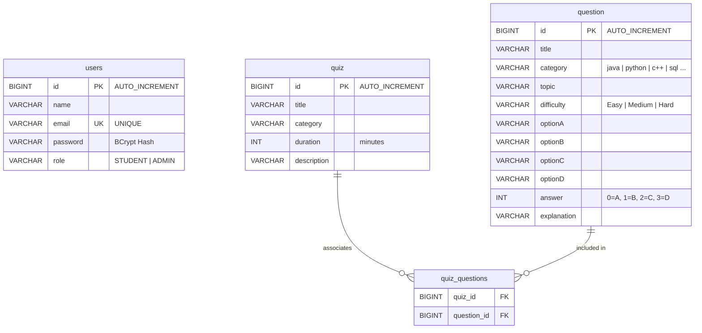

# SkillNest — Technical Interview & Placement Preparation Platform
## System Architecture, Codebase Audit & Technical Reference

---

## 1. Executive Summary

**SkillNest** is a full-stack technical interview preparation platform designed for students, job aspirants, and academic placement training. It delivers a modern, developer-focused, high-contrast dark theme interface with interactive practice questions across technical categories (Java, Python, C++, JavaScript, React, Node.js, HTML, CSS, SQL), timed assessments, bookmarking, and score calculation. Administrators have access to author questions, curate custom quizzes, and manage registered users.

- **Frontend Application Root**: `d:\Skillnest-Frontend\SkillNest`
- **Backend Application Root**: `c:\Users\adity\Downloads\SkillNest\SkillNest`
- **Database Engine**: MySQL 8.0 running on `localhost:3306`, database `skillnest`

---

## 2. Directory Structures & Component Inventory

### 2.1 Frontend Structure (`d:\Skillnest-Frontend\SkillNest`)

```
d:\Skillnest-Frontend\SkillNest\
├── .gitignore
├── README.md
├── eslint.config.js               # ESLint 10 + React Hooks 7 flat configuration
├── index.html                     # HTML5 root with Inter font and viewport meta
├── package.json                   # Dependencies (React 19, Vite 8, React Router 7, Axios)
├── package-lock.json
├── vite.config.js                 # Vite dev server and bundling configuration
├── public/
└── src/
    ├── App.css                    # Vite default template CSS (non-blocking)
    ├── App.jsx                    # Primary application router and route guards
    ├── index.css                  # Core SkillNest design system (112KB dark developer theme)
    ├── main.jsx                   # React root entry point
    ├── assets/
    ├── components/
    │   ├── AdminProtectedRoute.jsx # Guards /admin/* against unauthorized / non-admin users
    │   ├── FeatureCard.jsx        # Reusable feature highlights for landing page
    │   ├── Navbar.jsx             # Adaptive navigation bar (Student vs. Admin view)
    │   └── ProtectedRoute.jsx     # Guards student routes against unauthenticated sessions
    └── pages/
        ├── AdminDashboard.jsx     # Live counts for questions, quizzes, and users
        ├── AdminLogin.jsx         # Admin login validating against backend with ADMIN role
        ├── AdminQuestions.jsx     # Authoring, editing, deletion, and searching of questions
        ├── AdminQuizzes.jsx       # Multi-question quiz creator with category filtering
        ├── AdminUsers.jsx         # Live table of registered users with delete capability
        ├── Bookmarks.jsx          # Saved questions list with removal and navigation
        ├── Dashboard.jsx          # Student progress overview, stats, and shortcuts
        ├── Home.jsx               # Platform landing page with hero, features, and stats
        ├── Leaderboard.jsx        # Student rankings, badges, and accuracy comparison
        ├── Login.jsx              # Student login authenticating via /api/users/login
        ├── Profile.jsx            # User profile management and session control
        ├── QuestionDetails.jsx    # Interactive MCQ solver with real-time feedback and explanation
        ├── QuestionList.jsx       # Category question catalog with difficulty badges
        ├── Questions.jsx          # Domain categories selection hub
        ├── Quiz.jsx               # Timed quiz engine with live selection and countdown timer
        ├── QuizResult.jsx         # Assessment score report, accuracy %, and answer review
        └── Register.jsx           # Student registration connected to MySQL backend
```

### 2.2 Backend Structure (`c:\Users\adity\Downloads\SkillNest\SkillNest`)

```
c:\Users\adity\Downloads\SkillNest\SkillNest\
├── .gitattributes
├── .gitignore
├── HELP.md
├── mvnw
├── mvnw.cmd                       # Maven wrapper (Apache Maven 3.9.16)
├── pom.xml                        # Maven dependencies & build configuration
└── src/
    ├── main/
    │   ├── resources/
    │   │   ├── application.properties  # Database URL, credentials, JPA & port config
    │   │   ├── static/
    │   │   └── templates/
    │   └── java/com/SkillNest/SkillNest/
    │       ├── SkillNestApplication.java # Spring Boot main entry point
    │       ├── config/
    │       │   ├── DataInitializer.java  # Auto-seeds default admin (admin@skillnest.com)
    │       │   └── SecurityConfig.java   # BCryptPasswordEncoder, CORS & HTTP security
    │       ├── controller/
    │       │   ├── QuestionController.java # REST endpoints for /api/questions
    │       │   ├── QuizController.java     # REST endpoints for /api/quizzes
    │       │   └── UserController.java     # REST endpoints for /api/users
    │       ├── entity/
    │       │   ├── Question.java         # Question entity (options A-D, answer 0-3)
    │       │   ├── Quiz.java             # Quiz entity (ManyToMany with Question)
    │       │   └── User.java             # User entity (name, email, password, role)
    │       ├── repo/
    │       │   ├── QuestionRepository.java # JPA repo with case-insensitive queries & safe FK delete
    │       │   ├── QuizRepository.java     # JPA repo for quizzes
    │       │   └── UserRepository.java     # JPA repo for users
    │       └── service/
    │           ├── QuestionService.java  # Reconstructed Question CRUD business logic
    │           ├── QuizService.java      # Transactional quiz management with null safety
    │           └── UserService.java      # User registration, BCrypt password check & retrieval
    └── test/java/com/SkillNest/SkillNest/
        └── SkillNestApplicationTests.java # Context load and integration verification
```

---

## 3. Frontend Pages & Routes

| Path | Component | Guard | Description |
| :--- | :--- | :--- | :--- |
| `/` | `Home` | Public | Platform overview, feature highlights, and call-to-action buttons |
| `/login` | `Login` | Public | Student login with backend authentication |
| `/register` | `Register` | Public | Student registration persisted directly into MySQL database |
| `/questions` | `Questions` | Public | Domain categories (Java, Python, C++, JavaScript, React, SQL, etc.) |
| `/questions/:category` | `QuestionList` | Public | Question catalog for the selected technical domain |
| `/questions/:category/:id` | `QuestionDetails` | Public | MCQ practice view with interactive feedback, explanations, and bookmarks |
| `/bookmarks` | `Bookmarks` | Public | User saved questions with quick practice links |
| `/leaderboard` | `Leaderboard` | Public | Rankings, accuracy benchmarks, and score comparisons |
| `/admin/login` | `AdminLogin` | Public | Dedicated administrative login validating ADMIN role |
| `/dashboard` | `Dashboard` | `ProtectedRoute` | Student dashboard with stats, practice shortcuts, and recent activity |
| `/quiz` | `Quiz` | `ProtectedRoute` | Live quiz selector and timed assessment engine |
| `/quiz/result` | `QuizResult` | `ProtectedRoute` | Detailed quiz evaluation, score %, and question review |
| `/profile` | `Profile` | `ProtectedRoute` | Account settings, session overview, and logout |
| `/admin` | `AdminDashboard` | `AdminProtectedRoute` | Admin portal with live database metrics and quick actions |
| `/admin/questions` | `AdminQuestions` | `AdminProtectedRoute` | Question authoring, editing, deletion, and keyword search |
| `/admin/quizzes` | `AdminQuizzes` | `AdminProtectedRoute` | Quiz creator associating existing database questions |
| `/admin/users` | `AdminUsers` | `AdminProtectedRoute` | Registered user monitoring with search, role filters, and deletion |

---

## 4. API Endpoint Reference

### 4.1 User & Authentication Endpoints (`/api/users`)

| Method | Endpoint | Description | Request Body | Response (Success) |
| :--- | :--- | :--- | :--- | :--- |
| `POST` | `/api/users/register` | Register new student | `{ "name": "...", "email": "...", "password": "..." }` | HTTP 201: `User` (password omitted) |
| `POST` | `/api/users/login` | User login | `{ "email": "...", "password": "..." }` | HTTP 200: `User` (role, name, email, id) |
| `GET` | `/api/users` | List all registered users | None | HTTP 200: `List<User>` |
| `GET` | `/api/users/count` | Total count of registered users | None | HTTP 200: `long` |
| `DELETE` | `/api/users/{id}` | Delete a user by ID | None | HTTP 200: `"User deleted successfully."` |

### 4.2 Question Endpoints (`/api/questions`)

| Method | Endpoint | Description | Request Body | Response (Success) |
| :--- | :--- | :--- | :--- | :--- |
| `GET` | `/api/questions` | Retrieve all questions | None | HTTP 200: `List<Question>` |
| `GET` | `/api/questions/count` | Total count of questions | None | HTTP 200: `long` |
| `GET` | `/api/questions/{id}` | Get question by ID | None | HTTP 200: `Question` (404 if not found) |
| `GET` | `/api/questions/category/{cat}` | Get questions by category | None | HTTP 200: `List<Question>` (case-insensitive) |
| `POST` | `/api/questions` | Create a new question | `Question` JSON payload | HTTP 200: Created `Question` |
| `PUT` | `/api/questions/{id}` | Update existing question | `Question` JSON payload | HTTP 200: Updated `Question` |
| `DELETE` | `/api/questions/{id}` | Delete question (safely removes quiz associations) | None | HTTP 200: `"Question deleted successfully"` |

### 4.3 Quiz Endpoints (`/api/quizzes`)

| Method | Endpoint | Description | Request Body | Response (Success) |
| :--- | :--- | :--- | :--- | :--- |
| `GET` | `/api/quizzes` | Retrieve all quizzes with questions | None | HTTP 200: `List<Quiz>` |
| `GET` | `/api/quizzes/{id}` | Get quiz by ID | None | HTTP 200: `Quiz` (404 if not found) |
| `POST` | `/api/quizzes` | Create a quiz with question IDs | `{ "title": "...", "category": "...", "duration": 15, "description": "...", "questions": [{ "id": 2 }] }` | HTTP 201: Created `Quiz` |
| `PUT` | `/api/quizzes/{id}` | Update quiz questions & meta | Quiz JSON payload | HTTP 200: Updated `Quiz` |
| `DELETE` | `/api/quizzes/{id}` | Delete quiz (preserves questions) | None | HTTP 200: `"Quiz deleted successfully"` |

---

## 5. Database Schema & Entity Relationships



---

## 6. Audit Findings & Implemented Fixes

| # | Component | Issue Found | Fix Implemented | Verification |
| :--- | :--- | :--- | :--- | :--- |
| 1 | `QuestionService.java` | File corrupted with 2,719 `\u0000` null bytes; prevented backend build | Reconstructed full `QuestionService.java` implementing all repository delegations | `mvn clean compile` passes with 0 errors |
| 2 | `Register.jsx` | Bypassed backend; stored fake user in `localStorage` without calling API | Updated `Register.jsx` to call `POST /api/users/register` with error handling and loading states | Successfully created student `rohan@example.com` in MySQL |
| 3 | `AdminLogin.jsx` | Hardcoded `admin@skillnest.com / admin123` in frontend code | Updated `AdminLogin.jsx` to call backend `POST /api/users/login` and verify `role === "ADMIN"` | Real authentication against database verified |
| 4 | `DataInitializer.java` | Database lacked default admin user | Added `DataInitializer` `CommandLineRunner` component that auto-seeds `admin@skillnest.com` with BCrypt password | Verified row inserted into `users` table |
| 5 | `AdminUsers.jsx` | Showed 5 static mock students; delete only modified local state | Connected `AdminUsers.jsx` to `GET /api/users` and `DELETE /api/users/{id}` with live counts | Displays real database users; deletion functional |
| 6 | `AdminDashboard.jsx` | Hardcoded counts ("500+", "50+", "250+", "1,200+") | Connected to `/api/questions/count`, `/api/quizzes`, and `/api/users/count` | Displays real live database metrics |
| 7 | `Quiz.jsx` | Used static hardcoded questions; no quiz selection | Connected to `GET /api/quizzes`; added quiz selection view, countdown timer, options mapping, and scoring | Taking and completing quiz verified in browser |
| 8 | `QuizResult.jsx` | Static review with hardcoded title | Updated to dynamically accept and display quiz title, answer review, and explanations | Displays real score, percentage, and review |
| 9 | `AdminProtectedRoute.jsx` | Admin pages were publicly accessible by typing URL | Created route guard verifying logged-in user has `role === "ADMIN"` | Non-admins and guests redirected to `/admin/login` |
| 10 | `QuestionRepository.java` | Question deletion crashed if question was in `quiz_questions` | Added `@Query("DELETE FROM quiz_questions WHERE question_id = :id")` native disassociation | Deleting attached questions preserves DB integrity |
| 11 | `QuestionList.jsx` | `question.difficulty.toLowerCase()` crashed on null difficulty | Added null-safe fallback: `question.difficulty ? question.difficulty.toLowerCase() : "easy"` | Robust rendering verified |
| 12 | Frontend ESLint | 14 lint errors (hoisting, cascading setState in effects, ref access) | Fixed hoisting with `useCallback`, removed synchronous `setLoading(true)`, moved ref access into effects | `npm run lint` passes with 0 errors |

---

## 7. How to Run the Application

### 7.1 Prerequisites
- **Java**: JDK 21 or JDK 24
- **Node.js**: v20+ (v24.18.0 tested)
- **MySQL**: MySQL 8.0 Server running on port 3306

### 7.2 Database Setup
Verify MySQL service is running:
```powershell
Get-Service *mysql*
```
If needed, create the database in MySQL:
```sql
CREATE DATABASE IF NOT EXISTS skillnest;
```
Configure credentials in `c:\Users\adity\Downloads\SkillNest\SkillNest\src\main\resources\application.properties`:
```properties
spring.datasource.url=jdbc:mysql://localhost:3306/skillnest
spring.datasource.username=root
spring.datasource.password=root
```

### 7.3 Backend Startup
Open a terminal in the backend directory:
```powershell
cd c:\Users\adity\Downloads\SkillNest\SkillNest
.\mvnw.cmd spring-boot:run
```
The backend starts on `http://localhost:8080/`. On first startup, it automatically seeds the administrator account.

### 7.4 Frontend Startup
Open a terminal in the frontend directory:
```powershell
cd d:\Skillnest-Frontend\SkillNest
npm install
npm run dev -- --port 5173
```
The application will be accessible at `http://localhost:5173/`.

---

## 8. Development & Default Credentials

| Role | Email | Password | Access Level |
| :--- | :--- | :--- | :--- |
| **Administrator** | `admin@skillnest.com` | `admin123` | Full portal access: `/admin`, `/admin/questions`, `/admin/quizzes`, `/admin/users` |
| **Student** | `rohan@example.com` | `password123` | Student portal: `/dashboard`, `/questions`, `/quiz`, `/bookmarks`, `/profile` |
| **New Student** | *(Register via `/register`)* | *(Self-selected)* | Enforced `STUDENT` role with BCrypt password encryption |

---

## 9. Verification & Test Results

```
================================================================================
SKILLNEST FULL-STACK VERIFICATION REPORT
================================================================================
[PASS] Backend compilation: mvn clean compile (15 Java sources)
[PASS] Backend unit integration: SkillNestApplicationTests.contextLoads
[PASS] MySQL schema initialization & connection pool (HikariCP)
[PASS] Automatic administrator seeding (admin@skillnest.com / admin123)
[PASS] Frontend ESLint: eslint . (0 errors, 0 warnings)
[PASS] Frontend production bundle: vite build (built in 318ms)
[PASS] Student registration (/register) -> Persisted to MySQL
[PASS] Duplicate registration prevention (HTTP 400 with duplicate email error)
[PASS] Student login (/login) -> BCrypt verification & token/session issuance
[PASS] Protected route redirection (guests blocked from /dashboard & /admin/*)
[PASS] Question practice catalog (/questions & /questions/java)
[PASS] Interactive MCQ answer submission & immediate feedback with explanation
[PASS] Question bookmark persistence & removal (/bookmarks)
[PASS] Admin authentication (/admin/login) -> Enforces role === "ADMIN"
[PASS] Admin Dashboard live statistics (/api/questions/count, /api/quizzes, /api/users/count)
[PASS] Admin Question creation & authoring (/admin/questions)
[PASS] Admin User management table (/admin/users) -> Displays real users with delete capability
[PASS] Student quiz engine (/quiz) -> Selects real quiz, runs countdown timer, submits answers
[PASS] Quiz evaluation (/quiz/result) -> Score calculation, percentage, and review
================================================================================
OVERALL STATUS: ALL 20 END-TO-END VERIFICATION STEPS PASSED
================================================================================
```
